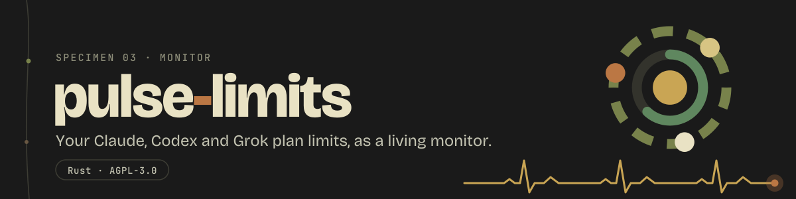
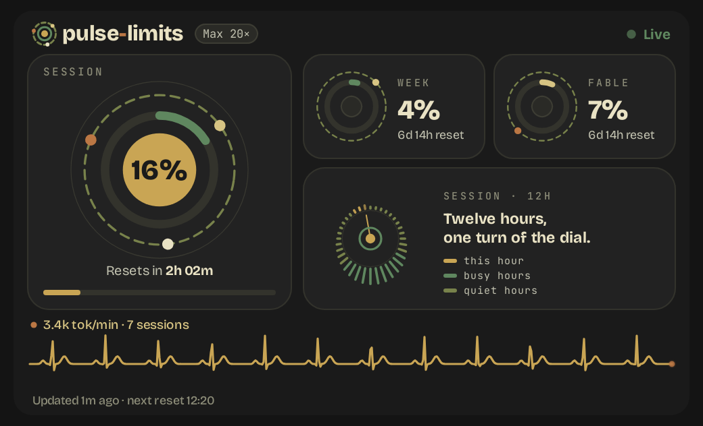
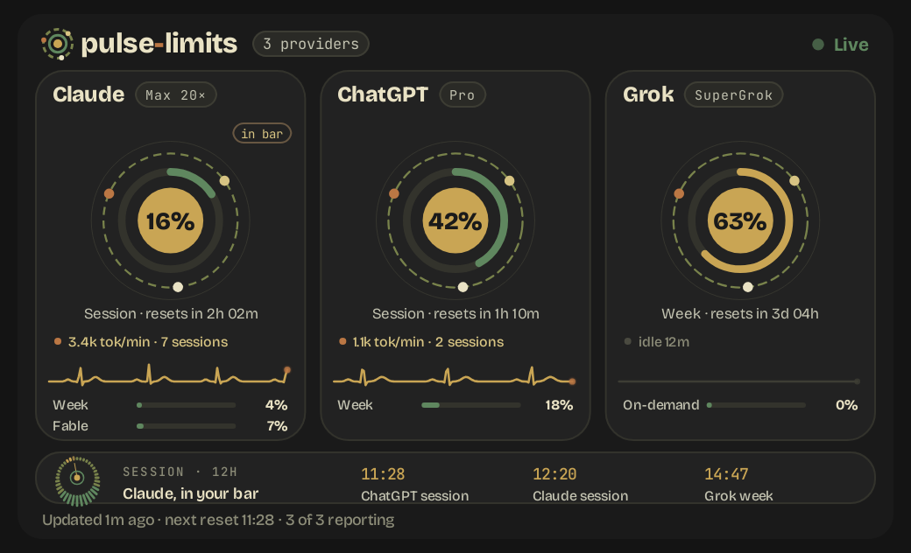
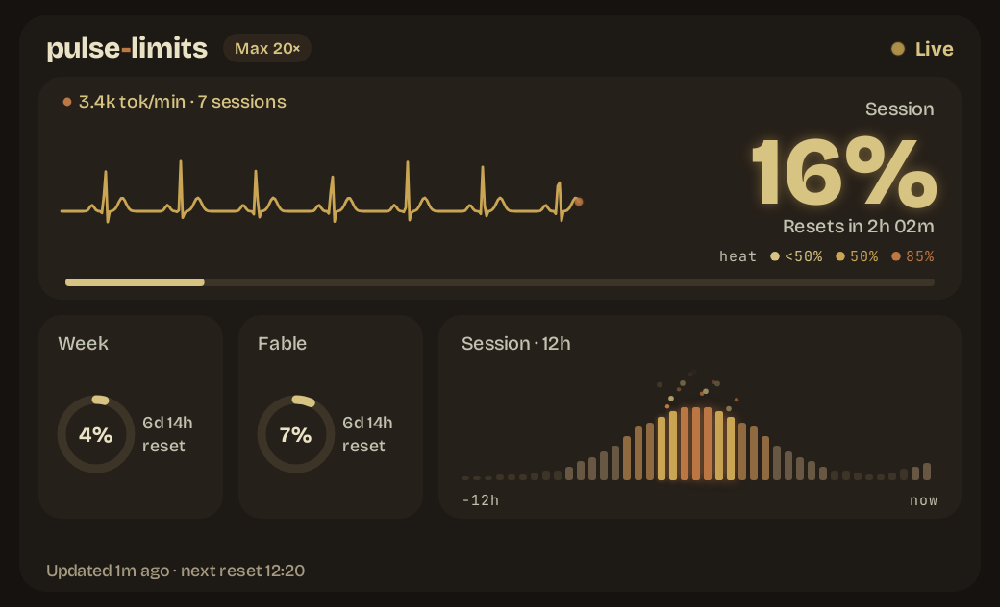
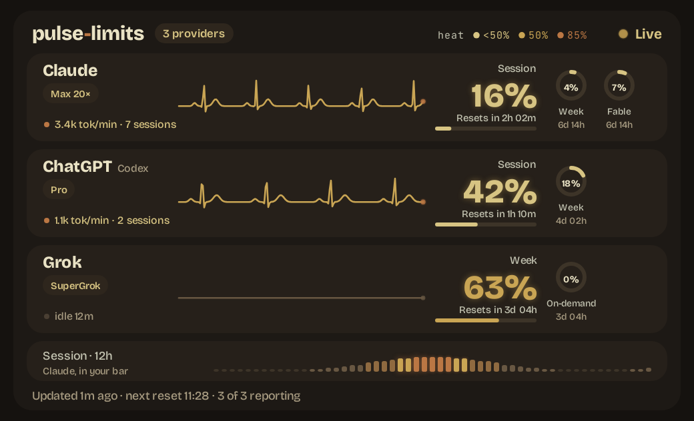
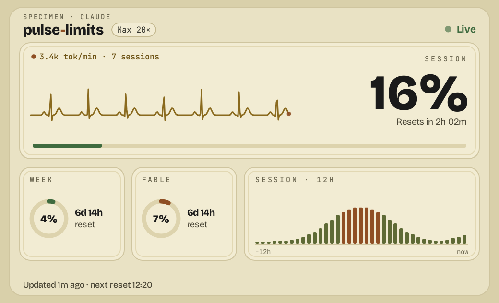
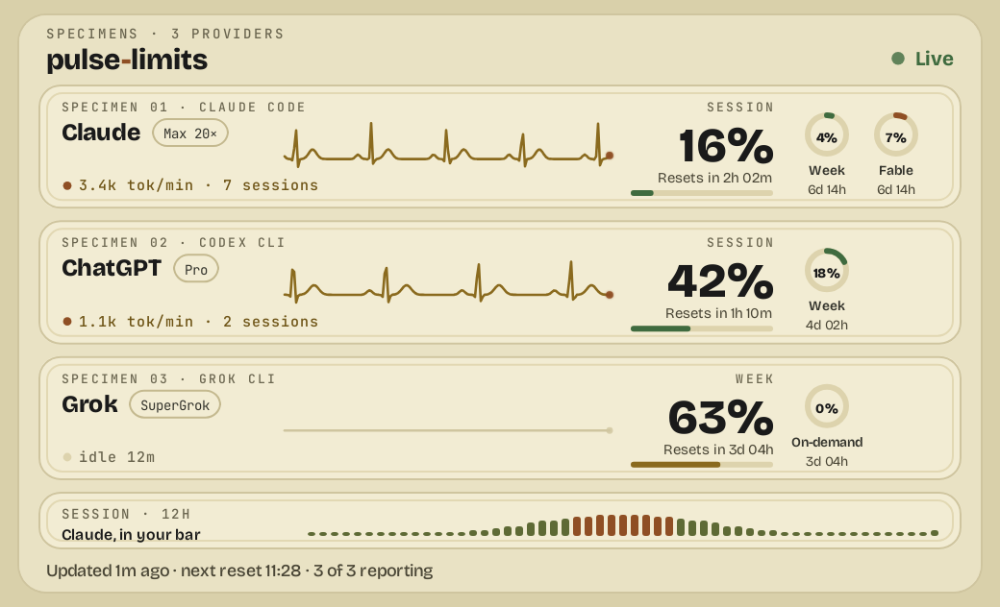

<p align="center">
  
</p>

<p align="center">
  <a href="https://github.com/pulse-null/pulse-limits/releases"></a>
  <a href="https://github.com/pulse-null/pulse-limits/actions/workflows/ci.yml"></a>
  <a href="https://coveralls.io/github/pulse-null/pulse-limits?branch=main"></a>
  
  
  <a href="https://github.com/pulse-null/homebrew-tap"></a>
  <a href="LICENSE"></a>
</p>

<p align="center">
  Your AI plan limits, Grok, Claude and Codex, in your status bar and in your terminal,
  as a living monitor: the heart rate is your usage.
</p>

One Rust binary, `pulse-limits`. It reuses the logins your CLIs already keep on the
machine and asks each provider's own usage endpoint once every five minutes. No account,
no server, nothing leaves the machine but those requests. The bar shows a ring with the
session percentage; a click opens the monitor; `pulse-limits tui` puts the same monitor
in a terminal tile.

## Install

### Linux

Arch, Manjaro, CachyOS, Debian, Ubuntu, Fedora, and Omarchy on any of them:

```sh
curl -fsSL https://raw.githubusercontent.com/pulse-null/pulse-limits/main/install.sh | bash
```

Nothing to edit: the installer puts the ring into your Waybar config and `style.css` (a
`.pulse-limits.bak` of each stays beside them), and `pulse-limits bar off` takes it out again.

NixOS with Home Manager managing Waybar: the config is generated by Nix, so declare the ring
like any other program and rebuild. If Home Manager does not manage your Waybar, the line
above works on NixOS too.

```nix
inputs.pulse-limits.url = "github:pulse-null/pulse-limits";    # flake.nix
imports = [ inputs.pulse-limits.homeManagerModules.default ];   # home.nix
programs.pulse-limits.enable = true;                            # home.nix
```

That adds the package, the Waybar entry and its colours. Optional, inside
`programs.pulse-limits`: `providers = [ "grok" "claude" ];` and `theme = "ember";`. If your
`programs.waybar.style` is a path, make it text: `builtins.readFile ./style.css`.

### macOS

```sh
brew install pulse-null/tap/pulse-limits && pulse-limits install
```

## Providers

There is no default. `install` enables the CLIs that have a login on the machine; toggle
them from the bar's provider menu or with `pulse-limits provider NAME`. The bar shows the
first enabled provider whose CLI is running right now, else the first enabled one; the
monitor and the TUI show all of them.

| Provider | Login it reuses | Where the numbers come from | Windows |
|---|---|---|---|
| `grok` | the Grok CLI's, `~/.grok/auth.json` | `cli-chat-proxy.grok.com/v1/billing`, the call the CLI makes for its credit pool; the plan name from `/v1/settings` | the weekly credit pool, on-demand spend when capped |
| `claude` | Claude Code's, `~/.claude/.credentials.json` on Linux, the Keychain on macOS | `api.anthropic.com/api/oauth/usage`, the call behind `/usage` in Claude Code | 5-hour session, week, per-model weekly caps |
| `codex` | the Codex CLI's, `~/.codex/auth.json` | `chatgpt.com/backend-api/wham/usage`, the call the CLI makes for its own rate limits | 5-hour, week, per-model extras |

## The monitor

- **The session number**, big, with its reset countdown. It warms as the window fills and
  turns rust near the limit.
- **The heartbeat** is your usage: its rate follows tokens per minute, and it goes flat when idle.
- **The other windows** as rings, **a 12-hour trend** of the session window, and honest
  failure states: `NO SIGNAL` with the reason when there is no reading.
- **Every connected provider** at once: one lane each for Claude, Codex and Grok.
- **Three themes**: `orbit` (the default), `ember` and `herbarium` (light), from the
  provider menu or `pulse-limits theme NAME`. The old theme names still work and move you
  to the closest new one.

| | One provider | Claude, Codex and Grok |
|:---|:---:|:---:|
| **Orbit** |  |  |
| **Ember** |  |  |
| **Herbarium** |  |  |

## TUI

```sh
pulse-limits tui                 # or: pulse-limits grok | claude | codex
pulse-limits tui --theme ember
```

The same monitor in a terminal, for a tmux pane or a tiling-WM tile: braille heartbeat, block
digits, bars, sparkline. Keys: `q` quit, `t` next theme, `r` reload, `?` help.

## Commands

```
pulse-limits install / uninstall   set up or remove the bar item
pulse-limits bar on|off|status     the bar item alone
pulse-limits provider NAME         enable or disable grok | claude | codex
pulse-limits theme NAME            orbit | ember | herbarium
pulse-limits tui [NAME]            the monitor in the terminal
pulse-limits open                  show or hide the monitor
pulse-limits status                the current reading as JSON, every provider
pulse-limits doctor                check every link of the chain, per provider
pulse-limits raw [NAME]            a provider's last raw usage reply
pulse-limits refresh               force a live fetch now
pulse-limits update / version
```

Plumbing, for scripts: `waybar`, `swiftbar`, `payload`, `activity`, `estimate PCT FETCHED`,
`reset`. Cache lives in `~/.cache/pulse-limits`, settings in `~/.config/pulse-limits`.

## Troubleshooting

`NO SIGNAL` means no reading at all; the header top-right says why (`? NO LOGIN`,
`? TOKEN EXPIRED`, `? NO PLAN ACCESS`, `? RATE LIMITED`, `? NETWORK`). Run
`pulse-limits doctor`: it checks every link per provider without printing tokens.

- **No login on this machine**: run `grok login`, `claude` or `codex login` once.
- **Token expired**: open that CLI once; it refreshes its own token. Grok's is also
  refreshed by pulse-limits itself while the CLI is closed.
- **Rate limited**: the usage endpoints have small per-account quotas, shared by every
  machine on the account; the binary backs off and keeps the last reading.

## License

GNU Affero General Public License v3.0 or later. Copyright (C) 2026 Daniel Nacenta.
